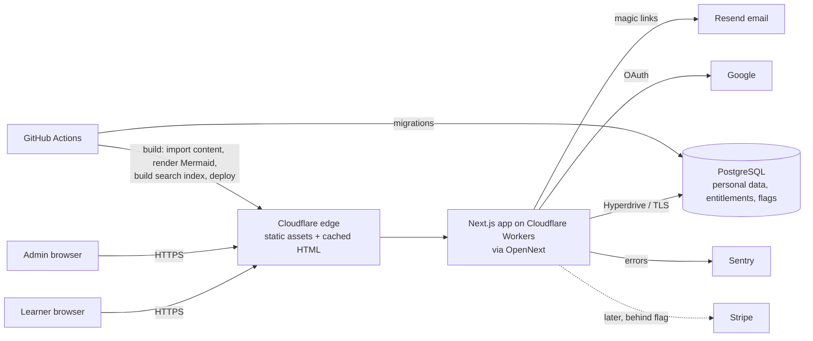
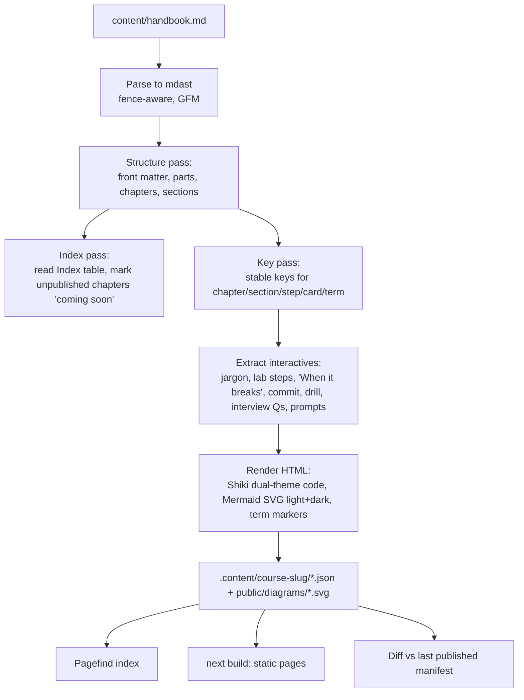
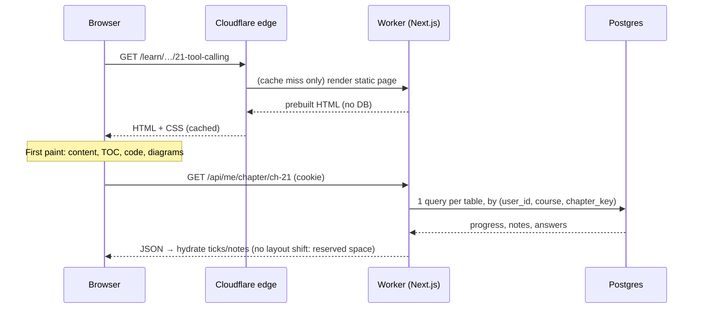

# Architecture — Handbook LMS

Owner: Chief Architect. Status: accepted for MVP. Decisions referenced as ADR-NNNN live in [`docs/adr/`](adr/).

## 1. Goals and constraints (summary)

| Driver           | What it means for the design                                                                                                   |
| ---------------- | ------------------------------------------------------------------------------------------------------------------------------ |
| Simple           | One deployable app (Next.js) + one database (Postgres). Every other service needs an ADR                                       |
| Seamless         | Content is pre-rendered at build time and served from the edge; personal state hydrates after first paint                      |
| Scalable         | 100k registered / 2k concurrent readers. Reading a chapter touches **no** database; only writes and personal reads do          |
| Swappable course | Courses are configuration (`content/courses.json` + a Markdown file), never code                                               |
| Secure / private | Server-side authorisation on every personal-data query, row ownership enforced in one data-access layer, UK GDPR export/delete |
| Cost             | < $50/month at launch (see §10)                                                                                                |

## 2. System context

Local development replaces Cloudflare with `next dev`/`next start`, Postgres and Mailpit in Docker Compose (ADR-0003, ADR-0014). Every external service is behind an environment variable with a safe local default; nothing external is required to run the app locally.

## 3. Components

| Component                                         | Responsibility                                                                                                                                                          | Tech                                                                  |
| ------------------------------------------------- | ----------------------------------------------------------------------------------------------------------------------------------------------------------------------- | --------------------------------------------------------------------- |
| **Content importer** (`src/content/`)             | Parse `handbook.md` → typed course model; assign stable keys; pre-render HTML; render Mermaid; emit glossary, quiz cards, search records; diff against previous release | unified/remark/rehype, Shiki, Mermaid via Playwright (ADR-0006, 0007) |
| **Generated content** (`.content/<course>/`)      | Build output of the importer: `course.json` (structure + keys), per-chapter HTML JSON, diagrams, glossary, cards. Not committed; regenerated every build                | JSON + SVG files                                                      |
| **Reader** (`app/(course)/…`)                     | Statically generated pages: course home, chapter, glossary, search. Personal overlays (progress ticks, notes, answers) load client-side from the API                    | Next.js App Router, server components, `generateStaticParams`         |
| **Personal API** (`app/api/me/…`, server actions) | Progress, labs, drills, flashcards, notes, bookmarks, certificates, export/delete                                                                                       | Route handlers, Zod validation, Drizzle                               |
| **Auth**                                          | Magic link + Google, sessions, rate limits, account deletion                                                                                                            | Better Auth (ADR-0005)                                                |
| **Admin** (`app/admin/…`)                         | Import diff preview + publish, analytics, flags, entitlements                                                                                                           | Server components, role check                                         |
| **Data access layer** (`src/server/db/`)          | The **only** place SQL runs. Every personal query takes `userId` from the session, never from input                                                                     | Drizzle (ADR-0004)                                                    |
| **Search**                                        | Static, chunked index generated at build                                                                                                                                | Pagefind custom records (ADR-0008)                                    |

## 4. Content pipeline

### 4.1 Parsing rules (derived from reading the handbook)

- **Always parse the AST, never regex lines.** `# ` lines appear inside bash/python code and inside a fenced README in a blockquote.
- `# Part N — Title` → part. `## Chapter N: Title` → chapter. `##` before Part 1 → front matter pages ("How to use this book", "The capstone…"). `## Index` is **data**, not a page: it is the only list of all 47 chapters + Chapter 0 + Appendix A.
- Chapters listed in the Index without a link (or absent from the body) are **coming soon**. Index anchors (`#mr7xe79p9rt.…`) are dead Google Docs anchors and are ignored; entries are matched by **number**.
- Parts 11–15 exist only in the Index; they are created from it.
- **Section types are matched by heading prefix**, not exact text (the template has variants):

  | Type key          | Matches heading starting with | Interactive behaviour                    |
  | ----------------- | ----------------------------- | ---------------------------------------- |
  | `jargon`          | `Jargon decoder`              | Glossary + hover terms                   |
  | `interview`       | `Interview questions`         | Flashcards                               |
  | `lab`, `lab-2`…   | `Practice lab`                | Checklist                                |
  | `drill`           | `Decision drill`              | Answer-before-reveal                     |
  | `stuck`           | `Stuck? Ask Claude`           | Copy prompts, highlight `[placeholders]` |
  | `judgment`        | `Where the judgment is`       | —                                        |
  | `further-reading` | `Further reading`             | —                                        |
  | anything else     | —                             | Key = slug of heading text               |

- `**Definition:**` is an inline paragraph (not a `###`); it becomes the chapter's summary/lede.
- **Labs**: `#### Step N — Title` (N may be `7b`) → checklist steps; `#### When it breaks` → collapsible table; `#### Commit it` **or** a `**Commit it…:**` paragraph (Chapters 1–6) → commit block; other `####` (e.g. "You now have", "SQLite vs Postgres") render as plain lab content. A final "I committed it" confirmation is always rendered (Chapter 2 has no commit marker). `**Time:** …` feeds the lab duration estimate.
- **Drills**: reveal boundary is the paragraph starting `**How an experienced engineer reasons` (two variants). Everything before = scenario + questions; everything after (including "What to tell the client" / "The answer that wins the work" / "Where this crosses departments") is hidden until the learner submits or skips.
- **Jargon tables** (`| Term | Plain meaning |`): terms with aliases (`Package / dependency`, `Asynchronous (async)`) produce multiple match forms. Duplicate terms across chapters (25) keep every definition, labelled by chapter.
- **Prompts**: italic list items in "Stuck?"; `\[…\]` placeholders are highlighted.
- **Raw HTML is disabled** (none exists outside code) — removes a whole XSS class.
- Section order is kept as authored (Ch 1–6 put "Stuck?" before the drill; Ch 7+ after).

### 4.2 Stable keys and idempotent re-import (ADR-0009)

| Entity        | Key                                          | Example                                        |
| ------------- | -------------------------------------------- | ---------------------------------------------- |
| Course        | slug from `courses.json`                     | `ai-engineering-handbook`                      |
| Chapter       | `ch-<number>` (front matter: `start-<slug>`) | `ch-21`                                        |
| Section       | type key or heading slug                     | `drill`, `lab-2`, `choosing-a-vector-database` |
| Lab step      | `step-<label>`                               | `step-7b`                                      |
| Flashcard     | `<chapter>:q-<hash8 of normalised question>` | `ch-1:q-3fa9c2d1`                              |
| Glossary term | slug of term                                 | `rate-limit`                                   |

URL slugs (`/learn/ai-engineering-handbook/21-tool-calling-function-calling`) are derived from titles for readability; the **key** is the number, so a title change only adds a redirect. Learner data references keys as strings — there are no foreign keys from personal tables into content, so a re-import can never cascade-delete progress. Removed keys are reported in the diff with the number of learners holding data on them; the data is kept (orphaned rows are harmless and reappear if the key returns).

Same input ⇒ byte-identical output (sorted keys, no timestamps in generated files), which is tested.

### 4.3 Publishing (ADR-0006)

`content/handbook.md` in Git is the source of truth. Two equivalent routes:

1. **Developer route:** replace the file, run `pnpm content:diff` locally, open a PR. CI posts the diff summary; merge to `main` deploys.
2. **Admin route:** upload a file at `/admin/content` → server parses and shows the diff (chapters added/changed/removed, key changes, learners affected) → **Publish** commits the file to `main` through the GitHub API (feature flag `content.githubPublish`, token in env). Without the token, the screen shows the diff and the CLI command to run instead.

Every publish records a `content_release` row (hash, summary, who) for audit.

## 5. Data model

```mermaid
erDiagram
    user ||--o{ session : has
    user ||--o{ account : "oauth links"
    user ||--o{ section_progress : ""
    user ||--o{ lab_step : ""
    user ||--o{ lab_completion : ""
    user ||--o{ drill_answer : ""
    user ||--o{ card_review : ""
    user ||--o{ note : ""
    user ||--o{ bookmark : ""
    user ||--o{ certificate : ""
    user ||--o{ entitlement : ""
    user ||--o{ activity_day : ""
    product ||--o{ entitlement : ""
    product ||--o{ bundle_item : "bundle contains"
    user {
      text id PK
      text email UK
      text name "certificate name"
      text role "learner|admin"
      timestamptz created_at
    }
    section_progress {
      text user_id PK
      text course PK
      text chapter_key PK
      text section_key PK
      timestamptz read_at
    }
    lab_step {
      text user_id PK
      text course PK
      text chapter_key PK
      text lab_key PK
      text step_key PK
      timestamptz done_at
    }
    lab_completion {
      text user_id PK
      text course PK
      text chapter_key PK
      text lab_key PK
      timestamptz committed_at
    }
    drill_answer {
      text user_id PK
      text course PK
      text chapter_key PK
      text answer
      timestamptz revealed_at
    }
    card_review {
      text user_id PK
      text course PK
      text card_key PK
      text rating "confident|unsure"
      int box "Leitner box"
      timestamptz due_at
    }
    note {
      uuid id PK
      text user_id
      text course
      text chapter_key
      text section_key
      text body
    }
    certificate {
      text id PK "random 128-bit, public"
      text user_id
      text course
      text scope "part:N | course"
      text name_snapshot
      timestamptz issued_at
    }
    product {
      text code PK
      text kind "free|paid|bundle"
      text course "nullable"
      int price_pence "nullable"
    }
    entitlement {
      text user_id PK
      text product_code PK
      text source "default|grant|purchase"
      timestamptz revoked_at
    }
```

Engagement (ADR-0019–0021): `xp_event` (PK `user_id, course, event_id` — idempotent awards), `activity_day`, `user_settings` (weekly goal, timezone), `reminder_pref`, `checkpoint_attempt`.

Also: `last_position` (continue where you left off), `feature_flag`, `content_release`, `rate_limit_bucket`, `admin_audit`, and Better Auth's `verification`. All personal tables have composite primary keys starting with `user_id`, giving natural upserts (idempotent writes) and an index for every per-user query. Full DDL is in `src/server/db/schema.ts`.

### Entitlements (ADR-0010)

- `product.kind`: `free` (core course), `paid` (e.g. `capstone-dental`), `bundle` (contains products via `bundle_item`).
- Access check: `hasAccess(user, productCode)` = product is free and the user is signed in, **or** an unrevoked entitlement exists for it or for a bundle containing it.
- Every course in `courses.json` names its `product`. Paid content is **never** emitted as public static assets: it is rendered at request time after the entitlement check.
- Stripe: `/api/webhooks/stripe` exists but returns 404 unless flag `payments.stripe` is on; on `checkout.session.completed` it will insert `entitlement(source='purchase')`. The integration point is one function, `grantEntitlement()`, already used by the admin screen.

## 6. Request flows

### 6.1 Reading a chapter (hot path — 2,000 concurrent)

Gating: `proxy.ts` (Next 16 middleware) redirects to sign-in if a page is not public and no session cookie is present. The cookie check is cheap and keeps the HTML cacheable. The real authorisation happens on every `/api/me` call, server-side, against the session. Course content is not secret (ADR-0015); personal data is.

### 6.2 Saving progress (offline-tolerant)

1. A UI action updates local state immediately and appends an op `{type, keys, value, clientTs}` to an IndexedDB outbox.
2. The outbox flushes (debounced 1 s, on `online`, on `visibilitychange`) as a batch `POST /api/me/ops`.
3. The server validates each op with Zod, applies idempotent upserts (keyed by the composite PK; last-write-wins on `clientTs`), and returns per-op results.
4. Ops survive reloads and offline periods; a badge shows "Saved" / "Saving…" / "Offline — will sync".

### 6.3 Sign-in

Magic link: email → rate-limited (5/hour/email, 20/hour/IP) → Resend (or Mailpit locally) → single-use, 10-minute token → session cookie (`HttpOnly; Secure; SameSite=Lax`). Google: OAuth code flow with PKCE via Better Auth. Accounts are linked by verified email.

### 6.4 Certificate

When a part's last required item completes, the server re-checks completion **from the database** (never trusts the client), creates `certificate` with a random 128-bit id, and the public page `/certificates/<id>` shows name, scope, course and date — nothing else. Learners can delete a certificate; account deletion removes all of them.

## 7. Scaling approach

- **Reads of content never hit the database.** Pages are static, cached at the edge with long `s-maxage` and invalidated by deploy.
- **Personal reads are one small indexed query per table** per chapter view. At 2,000 concurrent readers and a view every ~3 minutes ≈ 11 requests/s; progress writes are batched ≈ < 20/s. A single small Postgres handles thousands per second.
- **Connections:** Cloudflare Hyperdrive pools connections to Postgres (Workers would otherwise open one per isolate). Locally, `postgres.js` with a pool of 10.
- **Search is client-side** (Pagefind loads only the index chunks needed) — zero server cost per query.
- **Analytics queries** run on demand for admins against indexed tables, with a 5-minute cache; if they ever become slow, the upgrade path is a nightly rollup table (documented, not built).
- Verified by k6 load test in M6 (see test strategy).

## 8. Security model

| Concern (OWASP 2021)      | Control                                                                                                                                                                                                                                                                                           |
| ------------------------- | ------------------------------------------------------------------------------------------------------------------------------------------------------------------------------------------------------------------------------------------------------------------------------------------------- |
| A01 Broken access control | Personal data reachable **only** through `src/server/db/repo.ts`, whose functions take a `userId` from `requireSession()`. No route accepts a user id from input. Admin routes call `requireAdmin()`. Isolation tests: user B attempts every read/write against user A's keys and ids → 404/empty |
| A02 Crypto failures       | TLS everywhere; tokens hashed at rest by Better Auth; certificate ids from CSPRNG                                                                                                                                                                                                                 |
| A03 Injection             | Drizzle parameterised queries only; Zod validation on every input; Markdown rendered with raw HTML disabled; notes rendered as text, never HTML                                                                                                                                                   |
| A04 Insecure design       | Threat model in this doc; rate limits; entitlement checks server-side                                                                                                                                                                                                                             |
| A05 Misconfiguration      | Security headers (CSP with nonces, HSTS, `X-Content-Type-Options`, `Referrer-Policy`, `Permissions-Policy`, `frame-ancestors 'none'`), env validated at boot with Zod                                                                                                                             |
| A06 Vulnerable components | Renovate/Dependabot + `pnpm audit` in CI                                                                                                                                                                                                                                                          |
| A07 Auth failures         | Magic link single-use + expiry; rate limits on auth (ADR-0012); session rotation                                                                                                                                                                                                                  |
| A08 Integrity             | Stripe webhook signature verification (when enabled); lockfile, pinned CI actions                                                                                                                                                                                                                 |
| A09 Logging               | Structured logs with request id; no PII in logs (emails hashed); admin audit log                                                                                                                                                                                                                  |
| A10 SSRF                  | Server makes no user-controlled outbound requests                                                                                                                                                                                                                                                 |

CSRF: Better Auth origin checks; state-changing API routes require JSON `Content-Type` and same-origin `Origin`.

## 9. Privacy (UK GDPR)

- **Data collected:** email, optional name, auth records, learning state the learner creates. No tracking cookies; analytics is cookieless (ADR-0013) ⇒ **no consent banner** (only essential session cookie).
- **Export:** `/account` → "Download my data" returns JSON of every personal table.
- **Delete:** "Delete my account" (confirm by typing email) hard-deletes the user; `ON DELETE CASCADE` on every personal table; certificates disappear.
- **Retention:** sessions 30 days; unused magic links 10 min; inactive accounts: email warning at 24 months, deletion at 25 months (job in M6); logs 30 days; backups 7 days (point-in-time) so deleted data ages out within 7 days.
- **Admin analytics are aggregate only** — no per-learner view exists in the admin UI.

## 10. Cost model (launch scale)

| Item                                          | Plan                                        | $/month     |
| --------------------------------------------- | ------------------------------------------- | ----------- |
| Cloudflare Workers (+ Hyperdrive, edge cache) | Workers Paid                                | 5           |
| Postgres                                      | Neon Launch (or Supabase Pro)               | 0–19        |
| Email (magic links)                           | Resend free (3k/month) → Pro                | 0–20        |
| Sentry                                        | Developer (free)                            | 0           |
| Uptime checks                                 | UptimeRobot free / Cloudflare health checks | 0           |
| Analytics                                     | Cloudflare Web Analytics (free, cookieless) | 0           |
| Domain                                        | ~£10/year                                   | ~1          |
| **Total**                                     |                                             | **≈ $6–45** |

Main cost driver at scale is email volume (sign-ins) and database compute; both are monitored.

## 11. Environments

| Env        | Where                                              | Database                   | Email                     |
| ---------- | -------------------------------------------------- | -------------------------- | ------------------------- |
| local      | `pnpm dev` + Docker Compose                        | Postgres container         | Mailpit (web UI on :8025) |
| CI         | GitHub Actions                                     | Postgres service container | logged only               |
| preview    | Cloudflare Workers preview per PR (when connected) | Neon branch                | Resend test mode          |
| production | Cloudflare Workers                                 | Neon main (London)         | Resend                    |

Placeholders for Cloudflare, Resend, Google OAuth, Sentry and the domain are in `.env.example`; the app runs fully without them.
