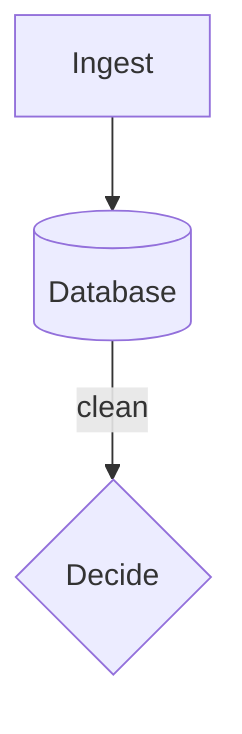

# Mini Handbook

## How to use this book

Intro text for the book.

### Every chapter follows the same template

| Section    | What it answers      |
| ---------- | -------------------- |
| Definition | The one-line version |

### Set up your machine

```bash
$ python --version
# A comment that looks like a heading
```

> **Tip:** quoted text
>
> ```
> ModuleNotFoundError: No module named 'httpx'
> ```

## Index

| Part                             | Chapters                                                                    | You can now |
| -------------------------------- | --------------------------------------------------------------------------- | ----------- |
| Start here                       | 0. Ship something in 60 minutes · Appendix A: Docker & your dev environment | Start       |
| [1. Foundations](#mr7xe79p9rt.1) | [1. Python](#mr7xe79p9rt.2) · 2. **[Git](#mr7xe79p9rt.3)**                  | Build       |
| 2. Later Part                    | 3. **Not written yet** · 4. Also not written                                | Later       |

## The capstone: what you build

Capstone overview.



# Part 1 — Foundations

Part one intro paragraph.

## Chapter 1: Python for AI

### Jargon decoder

| Term                          | Plain meaning                 |
| ----------------------------- | ----------------------------- |
| **Package / dependency**      | A library your project needs  |
| **Asynchronous (async)**      | Many things in flight at once |
| **Array (NumPy)**             | A grid of numbers             |
| **False positive / negative** | A wrong yes, or a wrong no    |

**Definition:** the language every AI library is written for.

### What it is

Python is readable. A **package** helps.

```python
# Wrong: each call blocks the next
for x in items:
    call(x)
```

### Interview questions

- How would you handle 100 concurrent requests?
- What happens on a 429?

### Practice lab: build the skeleton

**What you'll build:** a script.

**Time:** about 45 minutes.

#### Step 1 — Make a folder

```bash
$ mkdir lab
$ cd lab
Output line without a prompt
```

#### Step 2 — Write code

Write it.

#### When it breaks

| Error               | Cause         | Fix     |
| ------------------- | ------------- | ------- |
| `command not found` | Not installed | Install |

#### You now have

A skeleton.

**Commit it before moving on:**

```bash
$ git commit -m "Lab 01"
```

### Where the judgment is

**Safe to hand to an AI:** boilerplate.

### Stuck? Ask Claude

Useful prompts:

- _"I got \[paste full error\] on \[OS\]. What's wrong?"_
- _"Explain gather simply."_

### Decision drill: the overnight job

**The scenario.** 12,000 descriptions.

**What to ask:**

1. _Does it run once?_

**How an experienced engineer reasons:**

- Batch it.

**What to tell the client:** "Overnight is fine."

## Chapter 2: Git

### Jargon decoder

| Term                     | Plain meaning                         |
| ------------------------ | ------------------------------------- |
| **Package / dependency** | Something Git ignores in node_modules |

**Definition:** version control.

### Practice lab: version-control it

#### Step 1 — Init

Commit it:

```bash
$ git init
```

#### Step 7b — An extra step

Extra.

### Practice lab, part 2: hardening

#### Step 1 — Harden

Harden it.

#### Commit it

```bash
$ git push
```

### Decision drill: "the client who wants to own it"

**The scenario.** They want the code.

**How an experienced engineer reasons, cheapest first:**

- Hand it over.
